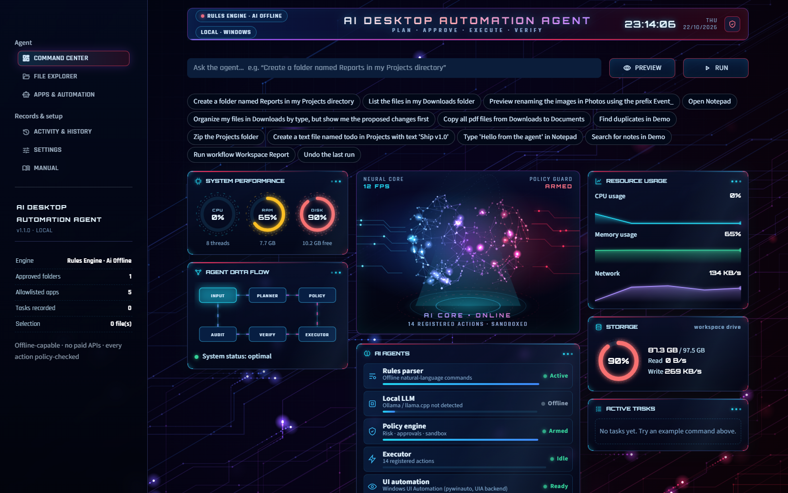

# AI Desktop Automation Agent

A local-first Windows automation agent. You type a task in plain English, it shows a step-by-step plan, asks for your approval when something is sensitive, then runs each step, verifies it and records it.

- **No paid APIs.** No API key, account or cloud AI service is needed. A built-in rules engine handles every supported command offline.
- **Optional local AI.** Ollama or llama.cpp can be added, using localhost only.
- **Streamlit UI** with a neon HUD dashboard. It runs locally through `run.bat` and can also be deployed to Streamlit Community Cloud as a sandboxed demo.



## Quick start (Windows)

1. Install **Python 3.11+** from python.org. Tick *Add python.exe to PATH* during installation.
2. Double-click **`setup.bat`**. This is one-time and needs no admin rights. It creates `.venv` and installs the dependencies.
3. Double-click **`run.bat`**. The agent opens at **http://localhost:8797**.
4. Try: `Create a folder named Reports in my Projects directory`, then `Organize my files in Downloads by type, but show me the proposed changes first`.

The full instruction manual is in **`docs/User_Manual.pdf`**. It is also in the app (Manual page, with a download button).

## Features

| Area | What works |
|---|---|
| Understanding | Rules-based natural-language parser. It asks clarifying questions instead of guessing. Optional Ollama or llama.cpp (localhost only, schema-validated output, timeouts, automatic fallback). |
| Planning | Each step lists its action, exact targets, preconditions, risk, confirmation requirement, expected result and verification method. |
| Files & folders | List or filter by extension, search, create, copy, move, rename (single or bulk with prefix, suffix or numbering), organize by type, find duplicates, zip, create text notes, delete to quarantine. |
| Desktop | Launch allowlisted apps, open approved files and folders, inspect accessible UI controls, type into a window the agent opened (Windows UI Automation via pywinauto), saved workflows. |
| Safety | Approved-folder sandbox (blocks `..`, absolute paths, symlink and junction escapes), app allowlist, LOW/MEDIUM/HIGH/BLOCKED policy engine, approval dialog, just-in-time confirmation, emergency STOP between actions, dry runs, conflict pause, never overwrites, Undo. |
| Records | SQLite history covering tasks, actions, approvals, verification and redacted errors. Export as TXT, CSV or JSON. Clear history. JSON-lines audit log. |
| UI | Animated HUD in the style of the reference image: gauges, data-flow pipeline, 3D neural core, agent status, live terminal, resource charts, storage, active tasks. Plus File Explorer, Apps & Automation, History, Settings and Manual pages. |

## Project layout

```
desktop-agent/
├── app.py                  # UI entry point = Streamlit Cloud main file (streamlit_app.py is an alias)
├── setup.bat / run.bat     # Windows setup and launcher (port 8797)
├── run_tests.bat / build_exe.bat
├── app/
│   ├── main.py             # local launcher (python -m app.main)
│   ├── services.py         # wires the layers together
│   ├── ui/                 # main_window, approval_dialog, settings_dialog, explorer/automation/history/manual pages, theme
│   ├── core/               # action_schema, planner, policy_engine, permissions, orchestrator, workspace_index, system_monitor
│   ├── actions/            # registry, filesystem, app_launcher, ui_automation
│   ├── llm/                # local_model (Ollama / llama.cpp), rules_fallback
│   ├── storage/            # database (SQLite), audit_log (redaction + JSON logs)
│   ├── manual/             # manual content + PDF builder
│   └── config/             # defaults.json, settings.py
├── tests/                  # 116 pytest tests (temp folders only)
├── demo_workspace/         # harmless sample files (default approved folder "Demo")
└── docs/                   # User_Manual.pdf, INSTALLATION.md, USER_GUIDE.md, SECURITY.md, screenshots/
```

## Deploy on Streamlit Community Cloud

Push this folder to GitHub. Then on share.streamlit.io, choose **New app**, pick the repo and set **Main file path** to `app.py`. The hosted app runs in **sandbox mode**: each visitor gets a private copy of the demo workspace and per-session settings and history. Desktop control is disabled, because a web server cannot control a visitor's PC. Use `run.bat` for the full desktop agent.

## Tests

`run_tests.bat` runs the suite. You can also run `python -m pytest -q`. Every test uses temporary folders, never your documents.

## Documentation

- [docs/INSTALLATION.md](docs/INSTALLATION.md)
- [docs/USER_GUIDE.md](docs/USER_GUIDE.md) (same content as the PDF)
- [docs/SECURITY.md](docs/SECURITY.md)

License: MIT (see LICENSE for third-party licenses).

## System Manager & multilingual Voice Assistant (v1.2)

- **System Manager** page: live CPU/RAM/disk/battery gauges, health score, per-core load, process manager
  (end / force end with protected-process policy), drives, network, services, startup apps, volume & media keys,
  Windows Settings shortcuts, lock / restart / shutdown (60 s, cancellable). All actions confirmed and logged.
- **Voice Assistant** page (pure Python): `st.audio_input` → offline **Vosk** speech-to-text → intent router →
  offline speech replies (Windows SAPI / bundled **espeak-ng**). 21 languages selectable, including **Urdu**
  (Urdu script + Roman Urdu), Hindi, Arabic, Persian, Turkish, French, Spanish, German, Chinese, Russian and more.
- Voice never executes directly: risky requests open a confirmation; agent tasks go through plan → policy → approval.

## Whole-PC control & better accuracy (v1.3)

- **Web:** `open youtube.com`, `open github.com in Chrome`, `search YouTube for lofi`, `google weather in Lahore`.
- **Message drafts:** `draft a Gmail to a@b.com about Lunch saying See you at 1`, `draft a WhatsApp message to +92… saying hi`
  open a pre-filled compose window — **you** review and press Send. The agent never signs in, types passwords or sends.
- **Programs & windows:** start any installed Start-menu program (`open vs code`), `list open windows`,
  `minimize/maximize/restore/switch to/close <window>`, browser tabs (`new tab`, `close this tab`, `next tab`, `reload`),
  `take a screenshot`.
- **Accuracy:** typo-tolerant verbs, fuzzy app/program/folder matching with visible assumptions, and "did you mean …?"
  suggestions for files.
