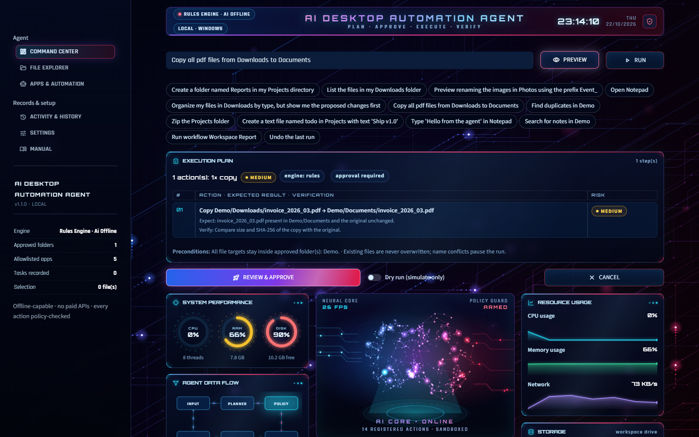
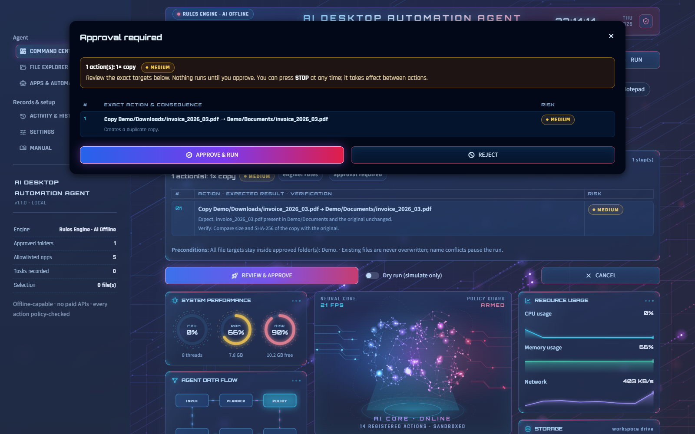
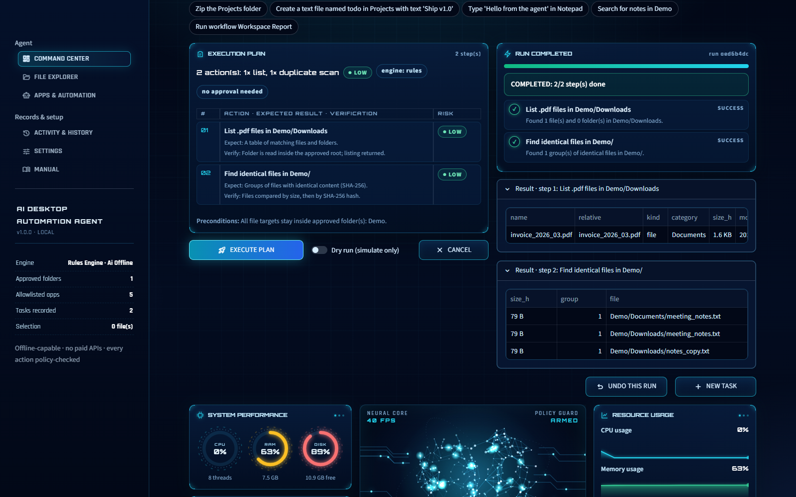

# AI Desktop Automation Agent — User & Instruction Manual

Version 1.1.0. The PDF version is `docs/User_Manual.pdf`.

## 1. What the agent does

The AI Desktop Automation Agent turns plain-English instructions into a visible, step-by-step plan, checks every step against a safety policy, asks for your approval when something sensitive is involved, then executes, verifies and records each action. It works fully offline with a built-in rules engine; a local AI model (Ollama or llama.cpp) is optional. No paid API, account or API key is ever needed.

- Files & folders: list, search, create, copy, move, rename, quarantine-delete, organize by type, find duplicates, zip, create text notes.
- Desktop: launch allowlisted apps, open approved files/folders, inspect accessible UI controls, type text into a window the agent opened (Windows UI Automation).
- Safety: approved-folder sandbox, risk levels, approval dialog, just-in-time confirmation, emergency STOP, dry runs, conflict detection, Undo, SQLite audit history.

## 2. Requirements

- Windows 10 or 11 (desktop features). File features also work on macOS/Linux and in the hosted demo.
- Python 3.11 or newer from python.org (tick 'Add python.exe to PATH' during install).
- About 300 MB disk space for the virtual environment. No administrator rights needed.
- Optional: Ollama (ollama.com) or a llama.cpp server for freer phrasing. A small model such as llama3.2:3b needs roughly 2-3 GB disk and 4+ GB RAM.

## 3. Installation

- Unzip the project, e.g. to Desktop\AI Desktop Automation Agent\desktop-agent.
- Double-click setup.bat. It checks Python, creates a private .venv folder and installs the dependencies (Streamlit, Pydantic, psutil, ReportLab, pywinauto). Internet is needed once for this.
- If setup reports an error, read the message: the most common cause is Python missing from PATH.
- Nothing outside the project folder is changed, apart from the data folder described below.

Manual alternative: python -m venv .venv, then .venv\Scripts\pip install -r requirements.txt.

## 4. Launching

- Double-click run.bat. The agent starts on http://localhost:8797 and your browser opens automatically. Keep the console window open while you work; close it to stop the agent.
- run.bat checks that setup.bat was run and shows a clear message if startup fails.
- Command line: .venv\Scripts\python -m app.main (same port 8797).
- Settings, history and logs are stored in %LOCALAPPDATA%\AIDesktopAutomationAgent.

## 5. Interface tour

| Area | Purpose |
|---|---|
| Sidebar | Navigation, live status and an always-visible emergency STOP while a run is active. |
| Command bar | Type a task. Preview builds a plan only; Run plans and starts (approval first if needed). |
| Example chips | One click fills the command bar with a supported example. |
| Execution plan | Every step with exact targets, expected result, verification method and risk. |
| Execution panel | Live progress, per-step status, pause decisions and the STOP button. |
| System performance | Real CPU, RAM and disk gauges (psutil). |
| Agent data flow | Pipeline Input > Planner > Policy > Executor > Verify > Audit; the active stage glows. |
| AI agents | Status of the rules parser, local LLM, policy engine, executor, UI automation and audit log. |
| Command terminal | Live log of the current run or recent events. |
| Resource usage / Storage | Live CPU, memory and network charts; workspace drive usage and I/O. |
| Active tasks | Progress of the running plan or the most recent tasks. |
| Workspace intel | Files, folders, size and quarantine count across approved folders; type breakdown; largest files. |
| Policy shield | How many plans were approved, auto-run, dry-run, rejected, refused or undone, plus the last refusal. |
| Quick relaunch | Your recent commands as one-click buttons, plus 'Undo last run'. |
| Background & theme | Animated red/blue circuit-board background and boot sequence; switch Dual Neon / Cyber Blue or turn effects off in Settings > Workspace. |

## 6. Writing commands

Type naturally. Name folders by their approved alias (e.g. Demo) or by a subfolder name (e.g. Photos). Chain steps with 'then'. Say 'preview', 'show me first' or 'don't move anything yet' for a dry run. If something is ambiguous the agent asks a question instead of guessing.

| Task | Example |
|---|---|
| Create folders | Create a folder named Reports in my Projects directory |
| Several folders | Make folders Alpha, Beta and Gamma in Archive |
| List / filter | List the pdf files in Downloads   \|   show images in Photos recursively |
| Search | Search for 'invoice' in Downloads |
| Copy / move | Copy all pdf files from Downloads to Documents   \|   move notes.txt to Archive |
| Rename one | Rename roadmap.txt to plan.txt |
| Bulk rename | Preview renaming the images in Photos using the prefix Event_ |
| Numbered rename | Rename the selected files to Holiday with numbers |
| Organize | Organize my files in Downloads by type, but show me the proposed changes first |
| Duplicates | Find duplicates in Demo |
| Zip | Zip the Projects folder |
| Text note | Create a text file named todo in Projects with text 'Ship v1.0' |
| Delete (quarantine) | Delete notes_copy.txt |
| Launch app | Open Notepad   \|   launch calculator |
| Open file / folder | Open report_draft.txt   \|   open the Photos folder |
| Type into app | Type 'Hello from the agent' in Notepad |
| Inspect UI | Inspect the Notepad window |
| Workflow | Run workflow Workspace Report |
| Selected files | Select files in File Explorer, then: rename the selected files with prefix X |

## 7. Plans, risk and approval

| Risk | Examples | What happens |
|---|---|---|
| LOW | List files, find duplicates, open an allowlisted app, create one folder | Runs after you press Run; still visible and stoppable. |
| MEDIUM | Copy, move, rename, create several folders, zip, create a file, type text | Approval dialog with exact targets (configurable). |
| HIGH | Delete (quarantine) files | Approval dialog + tick box + type APPROVE, and a second confirmation right before each step. |
| REFUSED | Send/upload/share, install software, change system settings | High-risk categories this version deliberately does not perform. |
| BLOCKED | Passwords/cookies, security bypass, stealth or persistence, shell commands, wiping drives | Never implemented. Refused before planning. |

The policy engine, not the language model, decides risk and approval. A model's plan is treated as untrusted data: it is validated against a strict schema and re-checked before every action.

## 8. Running, STOP, conflicts and dry runs

- Actions run one at a time. The STOP button (in the execution panel and the sidebar) sets a flag that is checked between actions: no new action starts after STOP. An action already in progress (e.g. copying a large file) is allowed to finish safely; the agent cannot promise to interrupt an operating-system call instantly.
- Partial completion is recorded honestly, e.g. 'CANCELLED: 2/4 steps done, 2 not run'.
- Keyboard shortcut for the sidebar EMERGENCY STOP: Ctrl+Shift+X.
- Existing files are never overwritten. On a name conflict the run pauses: skip the item, keep both (auto-rename to 'name (1).ext') or stop. A default can be set in Settings.
- Dry run simulates the plan against the planned disk state and reports what would happen. Press 'Execute this plan for real' afterwards to approve the real run.
- Each action is verified: copies by size + SHA-256, moves by source-gone/destination-present, ZIPs by integrity test, app launches by detecting the new window. Unverifiable results are marked UNVERIFIED instead of being reported as success.

## 9. File Explorer

- Browse approved folders, preview text files and images, and tick rows to select files.
- 'Use selection in Command Center' makes commands like 'rename the selected files ...' work.
- 'Set this folder as context' makes commands without a folder use it (stated as an assumption).
- Quick actions create, rename, copy, move, delete or organize via the same planner and approval flow.

## 10. Apps & Automation

- Applications: launch any allowlisted app; status shows whether it is installed.
- UI inspector: read-only list of a window's accessible controls (type, name, automation id).
- Typing: only into a window the agent opened itself in this session, located via accessibility controls, then read back to verify. If an app cannot be controlled reliably the step fails with an honest explanation.
- Workflows: save a list of commands and run them as one plan (each step still checked).

## 11. History, Undo and export

- Every task is stored in a local SQLite database with timestamp, request, engine, risk, approval decision, per-action results and verification flags. Error messages are redacted.
- Passwords, tokens, cookies and document contents are never stored.
- Undo reverses a task's file changes newest-first: moves and renames go back, created items go to quarantine, quarantined items are restored. It never overwrites and skips anything modified since.
- Type 'undo the last run' (or press Undo last run) to reverse the most recent file changes.
- Refused requests are logged too (status 'refused'); runs cut off by closing the app are marked 'interrupted'.
- Export as text report, CSV or JSON, download a PDF report for any single task; Clear history removes all records.

## 12. Settings

| Tab | What you can change |
|---|---|
| Approved folders | Add/remove folders, read-only or read-write. Drive roots, the whole home folder, Windows, Program Files and AppData are refused. |
| Applications | Allowlist .exe programs. Shells, script hosts and system tools are refused. |
| Local AI | Mode (auto / rules / ollama / llamacpp), local URLs, model, timeout, test connection. |
| Safety & execution | Approval for medium risk, JIT confirmation, conflict default, limits, pause between actions, verification timeout. |
| Workspace | History on/off, animations, reset demo workspace, restore defaults. |

## 13. Optional local AI (Ollama / llama.cpp)

- Install Ollama from ollama.com, then run once: ollama pull llama3.2:3b (internet needed for this one-time download; afterwards it runs offline).
- Settings > Local AI: keep mode 'auto' (rules first, model for phrasing the rules don't know) or choose 'ollama'. Press Test connection.
- llama.cpp: start llama-server with a GGUF model on port 8080 and choose 'llamacpp'.
- Only localhost URLs are accepted, so requests never leave your PC. Malformed or out-of-schema model output is rejected and the rules engine is used instead.

## 14. Safety and privacy summary

- Least privilege: only approved folders and allowlisted apps; '..', absolute paths, symlink and junction escapes are rejected after canonicalisation.
- No arbitrary execution: model or user text is never passed to eval, exec, a shell, PowerShell or Command Prompt. Only registered actions run.
- Visible operation only: no hidden windows, persistence, credential access or security changes.
- Local only: no telemetry, no cloud calls. Logs are redacted (secrets, e-mails, home path).

## 15. Deploying on Streamlit Community Cloud

- Push the desktop-agent folder to a GitHub repository (it already contains requirements.txt and .streamlit/config.toml).
- On share.streamlit.io choose New app, select the repo and set the main file to streamlit_app.py.
- The hosted app runs in 'sandbox mode': every visitor gets a private copy of the demo workspace, settings and history are per session, and desktop control is disabled because a web server cannot control a visitor's PC. Use run.bat locally for the full desktop agent.

## 16. Troubleshooting

| Problem | Fix |
|---|---|
| 'Python was not found' | Install Python 3.11+ from python.org with 'Add to PATH', then rerun setup.bat. |
| run.bat says setup is missing | Run setup.bat first; it creates the .venv folder. |
| Port already in use | Another copy is running. Close it or open http://localhost:8797. |
| App launch 'not found' | The program isn't installed (e.g. WordPad on new Windows 11). Remove it or allowlist another. |
| Launch 'unverified' | The app started but no new window was detected in time; raise the timeout in Settings. |
| Local LLM offline | Start Ollama and pull the model, or use mode 'rules'. |
| Folder not found | Name it exactly as shown in File Explorer, or approve it in Settings. |

## 17. Known limitations

- The rules engine understands the documented phrasings; very free-form requests need the optional local model.
- UI automation is limited to simple, accessible controls (e.g. Notepad's editor). Some apps expose poor accessibility data and cannot be controlled reliably.
- Opening a file with its default app cannot be verified (Windows does not report it).
- STOP takes effect between actions, not in the middle of an OS operation.
- PyInstaller packaging of Streamlit apps is possible (build_exe.bat) but larger and slower to start than run.bat; run.bat is the recommended launcher.
